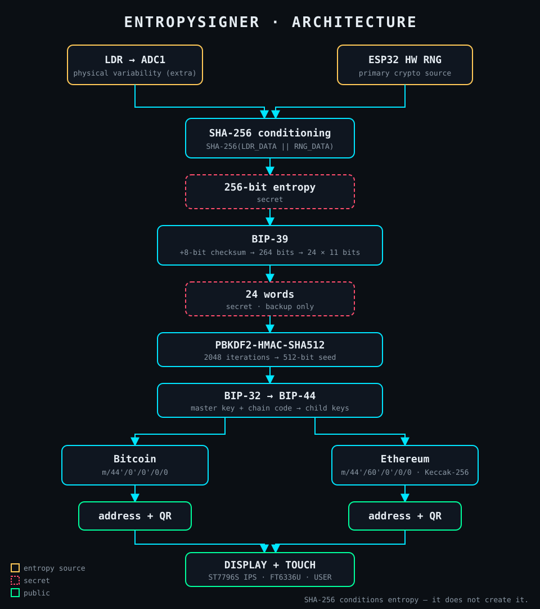
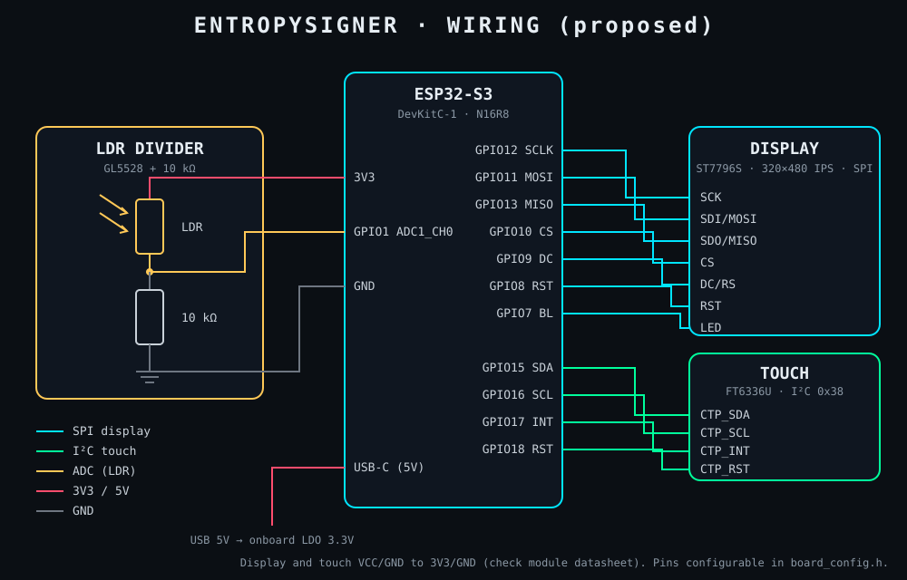

<p align="center">
  
</p>

# 🔐 EntropySigner

## ESP32 Educational Hardware Wallet

> **Open-source ESP32 hardware wallet prototype exploring physical entropy, hardware random generation, BIP-39 and hierarchical wallet derivation.**

**Descripción académica:** Diseño e implementación de un prototipo de Hardware
Wallet basado en ESP32 para el estudio de generación de entropía, BIP-39,
derivación jerárquica de claves y gestión de direcciones para Bitcoin y Ethereum.

> ⚠️ **Educational Hardware Wallet Prototype.** EntropySigner no es una
> hardware wallet comercial ni auditada. **No usar con fondos reales.**
> Inspiración conceptual: proyectos open-source como SeedSigner; la
> implementación, el diseño y la identidad de EntropySigner son propios.

---

## Features

| Feature | Descripción | Estado |
|---|---|---|
| ESP32 | ESP32-S3 con PSRAM y USB nativo | ✅ Firmware base (Paso 1) |
| Physical entropy | LDR leído por ADC1 como fuente adicional (crédito de entropía 0) | ✅ Implementado (Paso 4) |
| Hardware RNG | RNG de hardware del ESP32 con SAR ADC como fuente de ruido | ✅ Implementado (Paso 5) |
| SHA-256 | Acondicionamiento de entropía y checksum BIP-39 (mbedTLS) | ✅ Implementado (Pasos 6–7) |
| BIP-39 | Mnemonic de 24 palabras + validación + seed PBKDF2 | ✅ Implementado (Pasos 8–10) |
| BIP-32 | Derivación jerárquica de claves sobre secp256k1 | ✅ Implementado (Paso 11) |
| BIP-44 | Rutas estándar multi-moneda | ✅ Implementado (Pasos 12–13) |
| ₿ Bitcoin | `m/44'/0'/0'/0/0`, dirección P2PKH Base58Check | ✅ Implementado (Paso 12) |
| Ξ Ethereum | `m/44'/60'/0'/0/0` + Keccak-256 + EIP-55 | ✅ Implementado (Paso 13) |
| Touch UI | Máquina de estados táctil: generación, backup, direcciones | ✅ Implementado (Pasos 2–3, 15) |
| QR codes | Sólo direcciones públicas de recepción, offline | ✅ Implementado (Paso 14) |
| Seed backup | Advertencia obligatoria + 24 palabras + borrado de RAM | ✅ Implementado (Paso 16) |
| Entropy analysis | Herramienta Python, estimadores NIST SP 800-90B | ✅ Implementado (Paso 17) |
| Cross-verification | Implementación Python independiente contra los vectores de los tests C++ | ✅ 172 PASS / 0 FAIL (Paso 18) |
| Security model | Modelo de amenazas, ceroizado, air-gap, limitaciones | ✅ [`docs/SECURITY.md`](docs/SECURITY.md) (Paso 19) |

> Todo el firmware **compila** en ambos entornos y los vectores de prueba están
> verificados en forma cruzada con Python. La **ejecución en la placa física**
> (tests Unity en dispositivo, lectura real del LDR, escaneo de QR) queda
> pendiente hasta disponer de la ESP32-S3 con el display: ver
> [Criterios de finalización](#criterios-de-finalización).

---

## Architecture

<p align="center">
  
</p>

```
LDR ──► ADC ──► LDR DATA ─┐
                          ├──► SHA-256 (conditioning) ──► 256 bits
        ESP32 HW RNG ─────┘

256 bits ──► SHA-256 ──► 8-bit checksum ──► 264 bits ──► 24 × 11 bits ──► 24 words

24 words ──► PBKDF2-HMAC-SHA512 (2048) ──► 512-bit seed ──► BIP-32 ──► BIP-44
                                                                         │
                          ┌──────────────────────────────────────────────┤
                          │                                              │
                 Bitcoin m/44'/0'/0'/0/0                     Ethereum m/44'/60'/0'/0/0
                          │                                              │
                   address ──► QR                                 address ──► QR
```

**Principio de seguridad:** la fuente criptográfica principal es el **RNG de
hardware del ESP32**. El **LDR es una fuente física adicional** de variabilidad;
no se afirma que aporte 256 bits. **SHA-256 no crea entropía**: acondiciona los
datos y oculta estructura, pero no puede convertir una fuente pobre en una rica.

Detalle: [`docs/ARCHITECTURE.md`](docs/ARCHITECTURE.md)

---

## Hardware

| Componente | Propuesta |
|---|---|
| MCU | ESP32-S3-DevKitC-1 (N16R8) |
| Display | 3.5"–4.0" IPS · ST7796S · 320×480 · SPI |
| Touch | Capacitivo FT6336U · I²C |
| Entropía física | LDR GL5528 + 10 kΩ (divisor) → GPIO1 / ADC1_CH0 |
| Alimentación | USB-C 5 V → LDO 3.3 V |

<p align="center">
  
</p>

Detalle, pinout, BOM y alternativas: [`docs/HARDWARE.md`](docs/HARDWARE.md)

---

## Project Status

- [x] Paso 0 — Hardware analysis
- [x] Paso 1 — Project foundation
- [x] Paso 2 — Display
- [x] Paso 3 — Touchscreen
- [x] Paso 4 — LDR
- [x] Paso 5 — Hardware RNG
- [x] Paso 6 — Entropy conditioning
- [x] Paso 7 — SHA-256
- [x] Paso 8 — BIP-39
- [x] Paso 9 — Mnemonic validation
- [x] Paso 10 — PBKDF2
- [x] Paso 11 — BIP-32
- [x] Paso 12 — Bitcoin
- [x] Paso 13 — Ethereum
- [x] Paso 14 — QR
- [x] Paso 15 — Wallet UI
- [x] Paso 16 — Seed backup
- [x] Paso 17 — Entropy analysis
- [x] Paso 18 — Cryptographic tests
- [x] Paso 19 — Security hardening
- [x] Paso 20 — Final documentation
- [x] Paso 21 — Presentation

### Criterios de finalización

Se marca un criterio sólo cuando está **demostrado**. "Validado" significa que
el código compila y que sus vectores de prueba coinciden con una implementación
independiente en Python (`tools/verification/verify_cross.py`); lo que exige la
placa física se indica aparte.

- [ ] Hardware documentado *(propuesto en `docs/HARDWARE.md`; falta confirmar el hardware comprado)*
- [ ] ESP32 funcionando *(firmware compila en ambos entornos; falta probar en placa)*
- [ ] Display funcionando *(driver y pantallas implementados; falta probar en placa)*
- [ ] Touch funcionando *(detección FT6336U y botones implementados; falta calibrar en placa)*
- [ ] LDR funcionando *(muestreo implementado; falta capturar muestras reales)*
- [ ] RNG funcionando *(implementado; falta ejecutar en placa)*
- [ ] Entropy pipeline funcionando *(implementado y documentado; falta ejecutar en placa)*
- [x] SHA-256 validado *(vectores NIST FIPS 180-2; se corrigió un vector mal transcripto)*
- [x] BIP-39 validado *(8 vectores Trezor de 256 bits)*
- [x] 24 words funcionando
- [x] Checksum funcionando
- [x] PBKDF2 funcionando *(seeds de los vectores Trezor, passphrase `TREZOR`)*
- [x] BIP-32 funcionando *(test vectors 1 y 2 de BIP-32)*
- [x] BIP-44 funcionando
- [x] Bitcoin funcionando *(Base58 de Bitcoin Core + dirección BIP-44 de referencia)*
- [x] Ethereum funcionando *(Keccak-256 + vectores EIP-55 + dirección BIP-44 de referencia)*
- [ ] QR funcionando *(render implementado; falta escanear con un teléfono)*
- [ ] UI funcionando *(máquina de estados implementada; falta probar en placa)*
- [ ] Recovery flow funcionando *(`validateMnemonic`/`mnemonicToSeed` existen, pero la UI no permite ingresar un mnemonic: trabajo futuro)*
- [x] Entropy analysis funcionando *(sobre fuentes simuladas; falta capturar el LDR real)*
- [ ] Tests completos *(49 tests Unity escritos y compilados; falta ejecutarlos en la ESP32-S3)*
- [x] Security review *([`docs/SECURITY.md`](docs/SECURITY.md))*
- [x] README completo
- [x] Diagramas *(arquitectura, conexiones, y en `presentation/` pipeline BIP-39, derivación y máquina de estados)*
- [x] Presentación *([`presentation/slides.md`](presentation/slides.md))*
- [x] Guion de exposición *([`presentation/guion.md`](presentation/guion.md))*
- [x] Referencias *([`docs/SECURITY.md` §10](docs/SECURITY.md#10-referencias) y [References](#references))*
- [x] Limitaciones documentadas *([`docs/SECURITY.md` §8](docs/SECURITY.md#8-limitaciones-del-prototipo))*

---

## Repository structure

```
EntropySigner/
├── README.md · LICENSE · .gitignore · .editorconfig
├── platformio.ini              envs esp32s3-demo / esp32s3-prod
├── firmware/esp32/             particiones, config de placa, scripts de flasheo
├── src/
│   ├── main.cpp                arranque: Serial, display, touch, wallet UI
│   ├── config/                 build_config.h · board_config.h · pin_rules.h
│   ├── security/               secure_log.h (logs por modo) · secure_mem.h (ceroizado)
│   ├── system/                 device_info (chip, flash, PSRAM)
│   ├── entropy/                ldr_entropy · hw_rng · entropy_pool (SHA-256 conditioning)
│   ├── crypto/                 sha256 · ripemd160 · keccak256 · base58
│   ├── bip39/                  wordlist oficial · mnemonic · validación · PBKDF2 seed
│   ├── bip32/                  master key · CKDpriv/CKDpub · derivePath (secp256k1)
│   ├── bitcoin/                BIP-44 m/44'/0'/0'/0/0 · P2PKH
│   ├── ethereum/               BIP-44 m/44'/60'/0'/0/0 · Keccak-256 · EIP-55
│   ├── qr/                     qr_render (sólo datos públicos)
│   └── ui/                     LovyanGFX (ST7796S + FT6336U) · wallet_ui (máquina de estados)
├── tests/                      Unity: test_foundation · test_crypto · test_bip39 ·
│                               test_bip32 · test_bitcoin · test_ethereum (49 tests)
├── tools/
│   ├── entropy_analysis/       analyze_entropy.py (NIST SP 800-90B)
│   └── verification/           verify_cross.py (implementación Python independiente)
├── docs/                       HARDWARE.md · ARCHITECTURE.md · SECURITY.md
├── hardware/                   schematic/ · pcb/ · enclosure/ (a completar con el hardware real)
├── presentation/               slides.md · guion.md · defensa.md · assets/
└── assets/                     logo.svg · architecture.svg · circuit.svg
```

---

## Installation

1. Instalar PlatformIO: extensión **PlatformIO IDE** o
   `python -m pip install --user platformio`.
2. Abrir la carpeta del proyecto desde una **ruta local** (p. ej. `D:\...`), no
   desde la ruta de red `\\Criptoaprendices\d\...`: con rutas UNC el compilador
   no encuentra los fuentes.
3. Compilar: `python -m platformio run` (entorno `esp32s3-demo` por defecto).
4. Flashear: `python -m platformio run -t upload`; monitor serie con
   `python -m platformio device monitor` (115200 baudios).

Placa N16R8: ver el comentario en `platformio.ini` para habilitar 16 MB de flash y PSRAM.

## Usage

| Entorno | Uso |
|---|---|
| `esp32s3-demo` | Desarrollo y demostraciones. Banner **DEMO MODE** en pantalla, logs de depuración. |
| `esp32s3-prod` | Sin logs de depuración (se eliminan del binario), sin banner demo. |

Flujo en el dispositivo:

1. **BOOT → IDLE.** La pantalla de inicio muestra la lectura del LDR en vivo
   ("Pasa la mano sobre el sensor") y el botón **GENERAR WALLET**.
2. **GENERATING.** Entropía 256 bits → 24 palabras → seed → master key →
   direcciones BTC y ETH, con el progreso de cada paso en pantalla.
3. **BACKUP_WARNING → SHOW_MNEMONIC.** Advertencia obligatoria y luego las 24
   palabras numeradas. Al tocar **YA LAS ANOTE** el mnemonic se borra de la RAM.
4. **SHOW_BTC ⇄ SHOW_ETH.** Dirección de recepción y su QR. **TERMINAR**
   descarta la wallet: nada se guarda en flash.

Herramientas en la PC (Python 3, sólo biblioteca estándar; `--serial` requiere `pyserial`):

```powershell
python tools/verification/verify_cross.py                       # 172 checks C++ == Python
python tools/entropy_analysis/analyze_entropy.py --synthetic all  # estimadores SP 800-90B
python tools/entropy_analysis/analyze_entropy.py --file captura_ldr.txt --bits 12
```

---

## Development Steps (bitácora)

### Paso 0 — Hardware analysis

**Objetivo.** Inspeccionar el proyecto y el entorno, definir hardware y
arquitectura, y crear la estructura inicial del repositorio. Sin código de wallet.

**Implementación.**

- Inspección del workspace: vacío, sin código, sin Git, sin framework.
- Inspección del entorno: Git 2.55 y Python 3.13.7 instalados; PlatformIO no
  instalado; ningún ESP32 conectado por USB.
- Hardware propuesto: ESP32-S3-DevKitC-1 + display IPS ST7796S 320×480 SPI con
  touch capacitivo FT6336U + LDR GL5528 con divisor de 10 kΩ en GPIO1 (ADC1).
- Framework elegido: **PlatformIO + Arduino (ESP32)**, con acceso a las APIs de ESP-IDF.
- Arquitectura en capas; los módulos criptográficos serán independientes de
  Arduino para poder testearlos contra vectores oficiales.
- Hallazgo de diseño: en ESP32-S3 la fuente de entropía interna del RNG (sin
  radio) usa el SAR ADC, así que el muestreo del LDR y la lectura del RNG deben
  **secuenciarse** (se valida en el Paso 5).
- Hallazgo de entorno: el proyecto está en una ruta de red UNC con espacios; la
  terminal y el compilador no funcionan de forma confiable ahí. Se trabaja por
  la ruta local `D:\...`. Se agregó `.editorconfig` (UTF-8, LF).
- Identidad visual inicial (logo) y diagramas de arquitectura y de conexiones.

**Archivos creados.** `README.md`, `LICENSE`, `.gitignore`, `.editorconfig`,
`docs/HARDWARE.md`, `docs/ARCHITECTURE.md`, `assets/logo.svg`,
`assets/architecture.svg`, `assets/circuit.svg`, y `.gitkeep` en las carpetas de
la estructura.

**Cómo probar.** Abrir los SVG de `assets/` en el navegador; revisar
`docs/HARDWARE.md` y confirmar el hardware a comprar.

**Resultado.** Estructura y documentación base creadas; archivos en UTF-8 y SVG
verificados como XML bien formado.

**Commit.** `docs: add hardware analysis and system architecture`

### Paso 1 — Project foundation

**Objetivo.** Firmware mínimo que compile, inicialice Serial, display y touch
(si están conectados) y muestre `ENTROPYSIGNER` / `BOOT OK`, con estructura modular.

**Implementación.**

- `platformio.ini` con plataforma y bibliotecas en versiones fijas:
  `espressif32@6.9.0` (Arduino-ESP32 2.0.17 sobre ESP-IDF 4.4), `LovyanGFX@1.1.16`,
  `Unity 2.6.1`. Dos entornos: `esp32s3-demo` (por defecto) y `esp32s3-prod`.
- `config/build_config.h`: nombre, versión `0.1.0` y modo. Exige exactamente uno
  de `ES_MODE_DEMO` / `ES_MODE_PRODUCTION` (error de compilación si no).
- `config/pin_rules.h` + `config/board_config.h`: pinout de `docs/HARDWARE.md`
  con `static_assert` que impiden usar pines de strapping, USB o flash/PSRAM, y
  que obligan a que el LDR esté en ADC1.
- `security/secure_log.h`: `ES_LOG_INFO` (siempre) y `ES_LOG_DEBUG` (eliminado
  del binario en PRODUCTION).
- `system/device_info`: chip, núcleos, frecuencia, flash y PSRAM por Serial.
- `ui/lgfx_device.h` + `ui/display`: driver LovyanGFX para ST7796S por SPI. El
  touch FT6336U se detecta por I²C (reset + probe en `0x38`) y sólo se registra
  si responde. Pantalla de arranque con banner **DEMO MODE** en modo demo.
- WiFi y Bluetooth no se inicializan (el firmware no incluye esas bibliotecas).

**Archivos creados/modificados.** `platformio.ini`, `src/main.cpp`,
`src/config/build_config.h`, `src/config/board_config.h`,
`src/config/pin_rules.h`, `src/security/secure_log.h`,
`src/system/device_info.h`, `src/system/device_info.cpp`,
`src/ui/lgfx_device.h`, `src/ui/display.h`, `src/ui/display.cpp`,
`tests/test_foundation/test_main.cpp`, `README.md`, `docs/ARCHITECTURE.md`.

**Cómo probar.**

Sin hardware (compilación):

```powershell
python -m platformio run -e esp32s3-demo
python -m platformio run -e esp32s3-prod
python -m platformio test -e esp32s3-demo --without-uploading --without-testing
```

Con la ESP32-S3 conectada al puerto **UART/COM** de la DevKitC-1:

```powershell
python -m platformio run -e esp32s3-demo -t upload
python -m platformio device monitor
python -m platformio test -e esp32s3-demo      # 5 tests en el dispositivo
```

Salida esperada por Serial:

```
[ES] ENTROPYSIGNER v0.1.0
[ES] SECURE HARDWARE WALLET | ESP32 | mode: DEMO
[ES] Initializing...
[ES] Chip: ESP32-S3 rev 0, 2 cores @ 240 MHz
[ES] Display: initialized
[ES] Touch: detected (FT6336U @ 0x38)     <- "not detected" si no hay touch
[ES] BOOT OK
```

Con el display cableado se ve la pantalla de arranque (ENTROPYSIGNER, SECURE
HARDWARE WALLET, ESP32-S3, BOOT OK). Si los colores salen invertidos, compilar
con `-DES_DISPLAY_INVERT=1`.

**Resultado.**

| Verificación | Resultado |
|---|---|
| Build `esp32s3-demo` | ✅ RAM 6.3 % · Flash 11.4 % |
| Build `esp32s3-prod` | ✅ RAM 6.2 % · Flash 10.9 % |
| Build de `test_foundation` | ✅ compila; ejecución pendiente de hardware |
| Mensajes de depuración ausentes en PRODUCTION | ✅ verificado en `firmware.bin` |
| Warnings propios (`-Wall -Wextra`) | 0 (único warning: `REG_SPI_BASE`, interno de LovyanGFX) |
| Prueba en placa física | ⏳ pendiente (no hay ESP32 conectado) |

**Commit.** `feat: initialize EntropySigner firmware`

### Pasos 2–3 — Display y touchscreen

**Objetivo.** Dejar el display ST7796S y el touch FT6336U listos para la
interfaz de la wallet.

**Implementación.**

- El driver LovyanGFX del Paso 1 (`ui/lgfx_device.h`) cubre ambos periféricos:
  SPI a 40 MHz para el panel, I²C para el touch con reset y *probe* en `0x38`.
- Si el touch no responde, el firmware sigue funcionando: la UI se detiene en
  `IDLE` y lo informa por Serial, en lugar de colgarse.
- `ui::device()` expone el panel a los módulos de UI y QR (Paso 15), así el
  resto del firmware no depende de LovyanGFX.
- La lectura táctil se hace por *polling* desde `loop()` con detección de
  flanco (un toque = una acción), para evitar disparos repetidos al mantener
  el dedo.

**Archivos.** `src/ui/lgfx_device.h`, `src/ui/display.{h,cpp}`.

**Resultado.** Compila en ambos entornos. ⏳ Calibración de coordenadas y
orientación del touch pendientes de la placa física.

### Pasos 4–7 — Entropía física, RNG de hardware, acondicionamiento y SHA-256

**Objetivo.** Producir 256 bits de entropía acondicionada combinando el RNG de
hardware (fuente principal) con el LDR (fuente adicional).

**Implementación.**

- `security/secure_mem.h`: `secureMemzero()`, borrado que el compilador no
  puede eliminar (puntero `volatile` + barrera `asm`), base de toda la política
  de ceroizado.
- `crypto/sha256`: wrapper sobre mbedTLS 2.28 (API `*_ret`, acelerada por HW),
  con interfaz de una pasada y en streaming.
- `entropy/ldr_entropy`: `collectLdrSamples()` lee el divisor LDR por ADC1
  (12 bits) con 200 µs entre muestras.
- `entropy/hw_rng`: `fillRandomBytes()` envuelve `esp_fill_random()` entre
  `bootloader_random_enable()` / `disable()`, que activan el **SAR ADC como
  fuente de ruido físico**. Sin radio encendida, el RNG del ESP32-S3 sería sólo
  pseudoaleatorio.
- `entropy/entropy_pool`: `generateEntropy256()` calcula
  `SHA-256("EntropySigner/entropy-pool/v1" ‖ RNG 32 B ‖ flag ‖ 128 muestras LDR)`.
  El LDR se muestrea **antes** que el RNG: el SAR ADC no puede atender a la vez
  al RNG y al driver ADC, y además así un atacante que controle la luz no puede
  adaptarla a la salida del RNG.

**Decisión clave.** Al LDR se le acreditan **0 bits** de entropía: sólo aporta
defensa en profundidad. SHA-256 acondiciona, no crea entropía.

**Archivos.** `src/security/secure_mem.h`, `src/crypto/sha256.{h,cpp}`,
`src/entropy/{ldr_entropy,hw_rng,entropy_pool}.{h,cpp}`,
`tests/test_crypto/test_main.cpp`.

**Cómo probar.** `python -m platformio test -e esp32s3-demo -f test_crypto`
(vectores NIST de SHA-256, ceroizado, dos generaciones consecutivas distintas).

**Commit.** `feat(crypto): implement entropy pipeline, secure_memzero, and SHA-256 module`

### Pasos 8–10 — BIP-39: mnemonic, validación y PBKDF2

**Objetivo.** Convertir 256 bits de entropía en 24 palabras, validarlas y
derivar el seed de 512 bits.

**Implementación.**

- `bip39/bip39_wordlist`: la lista inglesa oficial (2048 palabras), generada
  desde `bitcoin/bips/bip-0039/english.txt` y verificada por su SHA-256;
  búsqueda binaria con `std::lower_bound`.
- `entropyToMnemonic()`: checksum = primeros 8 bits de SHA-256(entropía);
  264 bits → 24 índices de 11 bits.
- `validateMnemonic()` / `mnemonicToEntropy()`: formato canónico estricto
  (minúsculas, un espacio), palabras de la lista y checksum correcto.
- `mnemonicToSeed()`: PBKDF2-HMAC-SHA512 (mbedTLS, 2048 iteraciones, salt
  `"mnemonic" ‖ passphrase`). Exige un mnemonic válido: BIP-39 aceptaría
  cualquier cadena, pero en una wallet un typo crearía en silencio otra wallet.
- Todas las funciones son *fail-closed*: si fallan, ponen la salida a cero.

**Archivos.** `src/bip39/bip39_wordlist.{h,cpp}`, `src/bip39/bip39.{h,cpp}`,
`tests/test_bip39/test_main.cpp` (10 tests, los 8 vectores Trezor de 256 bits).

**Commit.** `feat(bip39): implement BIP-39 wordlist, mnemonic encoding/decoding and PBKDF2 seed derivation`

### Paso 11 — BIP-32 sobre secp256k1

**Objetivo.** Master key y derivación jerárquica de claves.

**Implementación.**

- `createMasterKey()`: `HMAC-SHA512("Bitcoin seed", seed)` → (k, c).
- `derivePrivateChild()` (CKDpriv, normal y *hardened*), `derivePublicChild()`
  (CKDpub), `toPublic()`, `fingerprint()`, `derivePath("m/44'/0'/0'/0/0")`.
- Aritmética de curva con mbedTLS ECP (`MBEDTLS_ECP_DP_SECP256K1`). La
  descompresión de claves públicas es propia, porque mbedTLS 2.28 no la soporta,
  y valida el punto contra la ecuación de la curva.
- Si I_L ≥ n o la clave resulta 0, se devuelve error sin saltar de índice en
  silencio.
- `crypto/ripemd160` + `hash160()`: el mbedTLS precompilado de Arduino-ESP32
  trae RIPEMD-160 **deshabilitado**, así que se implementó la especificación
  (sólo procesa datos públicos).

**Archivos.** `src/bip32/bip32.{h,cpp}`, `src/crypto/ripemd160.{h,cpp}`,
`tests/test_bip32/test_main.cpp` (11 tests: vectores 1 y 2 de BIP-32, CKDpub,
entradas inválidas, `wipe()`), vectores de Bosselaers en `test_crypto`.

**Commit.** `feat(bip32): implement BIP-32 HD wallet derivation on secp256k1 and RIPEMD-160/HASH160`

### Pasos 12–13 — Bitcoin y Ethereum (BIP-44)

**Objetivo.** Direcciones de recepción en las rutas estándar BIP-44.

**Implementación.**

- **Bitcoin** `m/44'/0'/0'/0/0`: clave pública comprimida → HASH160 →
  Base58Check con versión `0x00` → dirección P2PKH (`1…`).
  `crypto/base58` es propio (sobre SHA-256 de mbedTLS).
- **Ethereum** `m/44'/60'/0'/0/0`: clave pública descomprimida (64 B sin el
  prefijo `04`) → Keccak-256 → últimos 20 bytes → checksum EIP-55 (mayúsculas
  según el hash de la dirección en hex).
- `crypto/keccak256`: Keccak-f[1600] portable con el padding original `0x01`
  (no SHA3-256 de FIPS 202, que usa `0x06`). mbedTLS 2.28 no incluye SHA-3.
- Las claves privadas derivadas se borran apenas se obtiene la pública.

**Archivos.** `src/bitcoin/`, `src/ethereum/`, `src/crypto/base58.{h,cpp}`,
`src/crypto/keccak256.{h,cpp}`, `tests/test_bitcoin` (6 tests),
`tests/test_ethereum` (7 tests).

**Resultado.** Para el mnemonic de prueba `abandon … about` las direcciones
coinciden con las de referencia de BIP-44 (verificadas también en Python).

**Commit.** `feat(crypto): implement Bitcoin BIP-44 P2PKH and Ethereum EIP-55 with Keccak-256`

### Pasos 14–16 — QR, Wallet UI y backup de la semilla

**Objetivo.** Interfaz táctil completa: generar la wallet, respaldar las 24
palabras y mostrar las direcciones con su QR.

**Implementación.**

- `qr/qr_render`: `renderQr()` con `ricmoo/QRCode@0.0.1` (modo byte, ECC M),
  la versión más chica entre 1 y 6 que entre, zona de silencio de 4 módulos y
  dibujo por tramos horizontales. Como la biblioteca no valida la capacidad, el
  wrapper rechaza textos de más de 106 bytes. **Sólo recibe direcciones
  públicas**: el mnemonic nunca se codifica en QR.
- `ui/wallet_ui`: máquina de estados `BOOT → IDLE → GENERATING →
  BACKUP_WARNING → SHOW_MNEMONIC → SHOW_BTC ⇄ SHOW_ETH`, más `ERROR`.
- **Seed backup (Paso 16):** `BACKUP_WARNING` es obligatoria ("que nadie mire
  la pantalla, no saques fotos, anotalas en papel"); `SHOW_MNEMONIC` muestra
  las 24 palabras numeradas en dos columnas. Al salir de esa pantalla, por
  **YA LAS ANOTE** o **CANCELAR**, el mnemonic se borra con `secureMemzero()`.
- En `GENERATING`, entropía, seed y master key viven sólo en el stack y se
  borran antes de retornar. Si un paso falla, se borra todo y se informa cuál.

**Archivos.** `src/qr/qr_render.{h,cpp}`, `src/ui/wallet_ui.{h,cpp}`,
`src/ui/display.{h,cpp}`, `src/main.cpp`, `platformio.ini`.

**Resultado.** Ambos entornos compilan. ⏳ Escaneo del QR con un teléfono y
prueba del flujo táctil pendientes de la placa.

**Commit.** `feat(ui): implement offline QR code rendering and interactive touch Wallet UI`

### Paso 17 — Análisis de entropía (NIST SP 800-90B)

**Objetivo.** Medir, no suponer, cuánta entropía aporta cada fuente.

**Implementación.** `tools/entropy_analysis/analyze_entropy.py` implementa los
estimadores **6.3.1 MCV**, **6.3.2 Collision** y **6.3.8 Lag Prediction**,
Shannon, chi-cuadrado, autocorrelación (lags 1–10), los health tests RCT/APT
(§4.4) y la entropía de salida de SHA-256 según §3.1.5.1.2. Acepta archivos,
captura por puerto serie y cuatro fuentes simuladas (`trng`, `ldr`,
`ldr-attack`, `sha256-counter`).

**Resultado (N = 200 000).**

| Fuente | H_I (min-entropía) | Observación |
|---|---|---|
| `trng` | 7.29 bits/byte | Referencia |
| `ldr` | 3.16 bits/muestra de 12 bits | No IID: r₁ = 0.98; MCV sobrestima un 85 % |
| `ldr-attack` (linterna) | 0.30 bits/muestra | El Repetition Count Test **falla** |
| `sha256-counter` | 7.32 bits/byte | **0 bits reales**: los tests estadísticos no prueban aleatoriedad |

Conclusión: se confirma la política de crédito 0 para el LDR. Detalle en
[`docs/SECURITY.md` §5.3](docs/SECURITY.md#53-evaluación-según-nist-sp-800-90b).

### Paso 18 — Tests criptográficos y verificación cruzada

**Objetivo.** Asegurar que cada primitiva produce exactamente los valores de
los estándares.

**Implementación.**

- **49 tests Unity** en 6 suites (`test_foundation`, `test_crypto`,
  `test_bip39`, `test_bip32`, `test_bitcoin`, `test_ethereum`) con vectores
  oficiales: NIST FIPS 180-2, Bosselaers (RIPEMD-160), Trezor (BIP-39), BIP-32
  TV1–2, Bitcoin Core (Base58), Keccak y EIP-55. Incluyen casos de error
  (salida a cero) y propiedades (cambiar 1 bit de entropía cambia el mnemonic).
- `tools/verification/verify_cross.py`: implementación **independiente en
  Python** de todo el pipeline (RIPEMD-160, Keccak y secp256k1 desde sus
  especificaciones) que comprueba los mismos vectores y además que cada valor
  esperado aparece **literalmente** en `tests/*.cpp`.

**Resultado.** `172 PASS | 0 FAIL | 2 SKIP`, 123 literales confirmados.
**Hallazgo:** el vector NIST de 448 bits en `test_crypto` tenía los últimos
10 bytes mal transcriptos; quedó corregido.

### Paso 19 — Security hardening

**Objetivo.** Documentar el modelo de amenazas y justificar cada decisión.

**Implementación.** [`docs/SECURITY.md`](docs/SECURITY.md): activos y
adversarios (A1–A5), siete amenazas con riesgo residual (canal lateral,
manipulación del LDR, RNG predecible, volcado de memoria, glitching,
observación, kleptografía), política de ceroizado, air-gap verificable con
`grep`, justificación de SHA-256 como extractor, decisiones de BIP-32/39/44,
11 limitaciones y recomendaciones para un producto comercial (Secure Element,
Secure Boot, health tests en línea).

**Commit (Pasos 17–19).** `feat(security): add NIST SP 800-90B entropy analysis tool, Python cross-verification, and SECURITY.md`

### Paso 20 — Documentación final

**Objetivo.** README coherente con el estado real del proyecto.

**Implementación.** Tabla de *Features* y *Project Status* actualizadas;
criterios de finalización marcados sólo cuando están demostrados (lo que
requiere la placa queda explícito); estructura del repositorio, flujo de uso,
bitácora de los Pasos 2–21, limitaciones y referencias.

**Resultado.**

| Verificación | Resultado |
|---|---|
| Build `esp32s3-demo` | ✅ RAM 6.5 % · Flash 13.8 % |
| Build `esp32s3-prod` | ✅ RAM 6.5 % · Flash 13.3 % |
| `verify_cross.py` | ✅ 172 PASS · 0 FAIL |
| Tests Unity en dispositivo | ⏳ pendiente de hardware |

### Paso 21 — Presentación y defensa oral

**Objetivo.** Material para la exposición y la defensa del trabajo.

**Implementación.** En [`presentation/`](presentation/):

- [`slides.md`](presentation/slides.md): 16 diapositivas en Markdown compatible
  con [Marp](https://marp.app/), con los diagramas del pipeline BIP-39, la
  derivación BIP-32/44 y la máquina de estados.
- [`guion.md`](presentation/guion.md): guion de exposición de ~20 minutos con
  tiempos por diapositiva, guion de la demo y plan B sin hardware.
- [`defensa.md`](presentation/defensa.md): preguntas probables del tribunal
  con respuestas cortas y la referencia al código o documento que las respalda.

**Cómo probar.** `npx @marp-team/marp-cli presentation/slides.md --pdf`, o
abrir `slides.md` en VS Code con la extensión *Marp for VS Code*.

---

## Security

Modelo de amenazas, política de ceroizado, aislamiento air-gapped,
justificación del pipeline de entropía y recomendaciones para un producto
comercial: [`docs/SECURITY.md`](docs/SECURITY.md).

Garantías que el firmware **sí** implementa:

- **Ningún secreto en flash**: sin NVS, `Preferences`, EEPROM ni sistema de archivos.
- **Sin radio**: WiFi y Bluetooth nunca se inicializan.
- **Ceroizado** de entropía, mnemonic, seed y claves en todos los caminos de salida.
- **QR y Serial sólo con datos públicos**; en PRODUCTION los logs de depuración no existen en el binario.
- **LDR con crédito de entropía 0**: la seguridad descansa en el RNG de hardware.

## Limitations

Lista completa en [`docs/SECURITY.md` §8](docs/SECURITY.md#8-limitaciones-del-prototipo). Las principales:

- Prototipo académico, **no auditado**; no usar con fondos reales.
- Sin Secure Element, Secure Boot ni flash encryption: con acceso USB se puede
  reemplazar el firmware.
- Sin protección contra canales laterales ni inyección de fallos.
- Sin health tests en línea sobre el RNG ni el LDR.
- Sin PIN, sin recuperación desde un mnemonic existente y sin firma de transacciones.
- El análisis del LDR usa datos simulados hasta capturar muestras reales.
- Los tests Unity están compilados pero no se ejecutaron todavía en la placa.

## Academic Context

Proyecto de la materia **Criptografía y Seguridad** (2026, 2.º semestre).
Material de exposición y defensa en [`presentation/`](presentation/).

## References

- BIP-32 *Hierarchical Deterministic Wallets* · BIP-39 *Mnemonic code for generating deterministic keys* · BIP-44 *Multi-Account Hierarchy for Deterministic Wallets*.
- EIP-55 *Mixed-case checksum address encoding*.
- NIST FIPS 180-4 (SHA-256) · FIPS 202 (SHA-3/Keccak) · SP 800-90B (fuentes de entropía) · SP 800-132 (PBKDF2).
- SEC 2 v2, *Recommended Elliptic Curve Domain Parameters* (secp256k1).
- Dobbertin, Bosselaers, Preneel, *RIPEMD-160: A Strengthened Version of RIPEMD*, 1996.
- Bertoni, Daemen, Peeters, Van Assche, *The Keccak Reference* v3.0.
- Espressif, *ESP32-S3 Technical Reference Manual* y documentación de ESP-IDF v4.4 (`esp_random`, `bootloader_random_enable`).
- Bibliografía completa: [`docs/SECURITY.md` §10](docs/SECURITY.md#10-referencias).

## License

[MIT](LICENSE)
