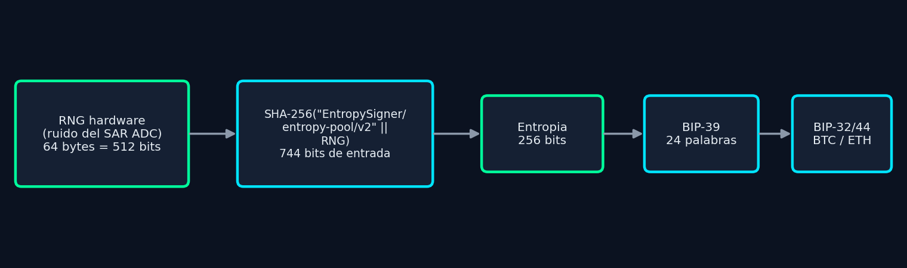
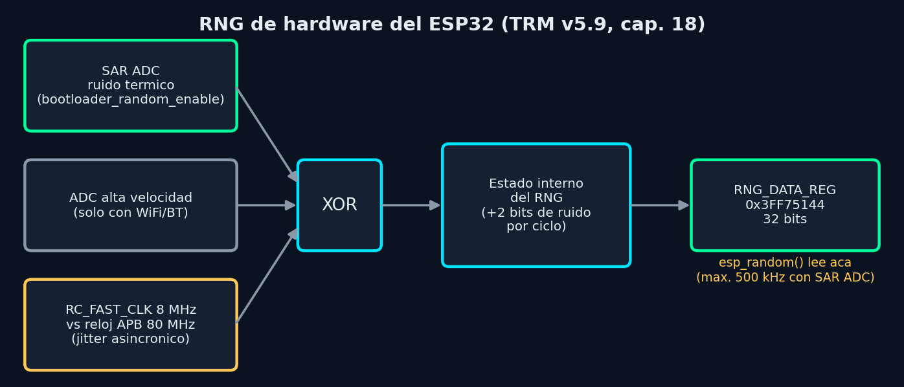
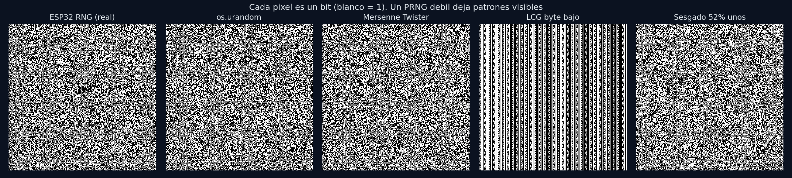

# EntropySigner — Guía de estudio

## Aleatoriedad, el RNG de hardware del ESP32 y cómo se verifica con NIST

**Proyecto:** EntropySigner — generador de wallets BIP-39 offline sobre ESP32

**Integrantes:** Integrante 1 · Integrante 2 · Integrante 3

**Material complementario:** presentación `presentation/EntropySigner_RNG.pptx`, simulador `simulator/index.html`, laboratorio `simulator/laboratorio.html`

---

## 0. Cómo usar esta guía

La guía está pensada para que **los tres integrantes puedan responder cualquier pregunta**, aunque cada uno exponga una parte. Las secciones marcadas con ★ son las que la profesora tiene más probabilidad de preguntar.

| Integrante | Parte de la exposición | Secciones de esta guía |
|---|---|---|
| **1** | El problema: qué es la aleatoriedad, por qué una wallet la necesita, TRNG vs PRNG, casos reales de wallets robadas | 1, 2 |
| **2** | El RNG de hardware del ESP32: de dónde sale el ruido, cuándo es verdadero y cuándo pseudoaleatorio, cómo lo usa nuestro firmware y la corrección que hicimos | 3, 4 |
| **3** | La demostración: NIST SP 800-22 y SP 800-90B, resultados, qué prueban y qué no; cierre con BIP-39 y demo | 5, 6, 7 |

Las preguntas probables con sus respuestas están en la sección 8.

---

## 1. El proyecto en una página

EntropySigner es un dispositivo **offline** (sin WiFi ni Bluetooth) que genera una wallet de criptomonedas:

1. Junta **entropía física**: 64 bytes (512 bits) del generador aleatorio por hardware (RNG) del ESP32, que es la única fuente.
2. Los **acondiciona** con SHA-256 y obtiene 256 bits de entropía.
3. Convierte esos 256 bits en una frase **BIP-39 de 24 palabras**.
4. Deriva las claves con **PBKDF2 → BIP-32 → BIP-44** y muestra las direcciones de Bitcoin y Ethereum en una pantalla táctil de 320×480.



**La seguridad de todo el sistema depende del paso 1.** Si los 256 bits no son impredecibles, todo lo demás —SHA-256, curvas elípticas, BIP-32— no sirve: un atacante que pueda adivinar la entropía puede regenerar la wallet y vaciarla.

**Hardware:** ESP32 DOIT DevKit V1 (chip ESP32-D0WD-V3, doble núcleo Xtensa LX6 a 240 MHz), pantalla ST7796S con touch capacitivo FT6336U. La entropía no necesita ningún componente externo: sale del propio chip.

---

## 2. Conceptos fundamentales ★

### 2.1 ¿Qué es "aleatorio"?

Una secuencia es aleatoria (para criptografía) si **nadie puede predecir el próximo bit con probabilidad mejor que 1/2**, aunque conozca todos los bits anteriores y el diseño del generador. No alcanza con que "parezca" desordenada: tiene que ser **impredecible**.

### 2.2 Entropía: cuánta incertidumbre hay

La entropía mide cuántos bits de incertidumbre tiene una fuente. Hay dos definiciones y **la diferencia importa**:

- **Entropía de Shannon:** H = −Σ pᵢ · log₂ pᵢ. Es un promedio.
- **Min-entropía:** H∞ = −log₂(p_max), donde p_max es la probabilidad del valor más probable.

Para claves se usa la **min-entropía**, porque un atacante prueba primero el valor más probable. Siempre se cumple H∞ ≤ H, así que Shannon **sobrestima** la seguridad.

*Ejemplo:* una moneda cargada que sale cara el 90% de las veces tiene H = 0,47 bits pero H∞ = −log₂(0,9) = 0,15 bits por tirada.

**256 bits de min-entropía** significan que el atacante necesita en promedio 2²⁵⁵ intentos. A mil millones de millones (10¹⁸) de intentos por segundo tardaría unos 10⁵¹ años; el universo tiene 1,4 × 10¹⁰ años.

### 2.3 TRNG, PRNG, CSPRNG y DRBG ★

| Tipo | Cómo funciona | ¿Predecible? | Ejemplo |
|---|---|---|---|
| **TRNG** (True RNG) | Mide un fenómeno físico impredecible: ruido térmico, jitter de relojes, desintegración radiactiva | No, por la física | Ruido del SAR ADC del ESP32 |
| **PRNG** (Pseudo RNG) | Algoritmo determinista: a partir de una **semilla** calcula la secuencia | **Sí**, si se conoce la semilla o el estado | `rand()` de C, Mersenne Twister |
| **CSPRNG** | PRNG diseñado para que, sin la semilla, sea imposible distinguirlo de aleatorio ni predecirlo | Solo si se conoce la semilla | `/dev/urandom`, ChaCha20 |
| **DRBG** | Nombre del NIST para un CSPRNG estandarizado (SP 800-90A) | Igual que CSPRNG | CTR-DRBG, HMAC-DRBG |

Idea clave: **un PRNG nunca crea entropía**, solo la "estira". Si la semilla tiene 32 bits, la salida tiene como máximo 32 bits de entropía, aunque se generen gigabytes. Por eso los sistemas serios combinan un TRNG (para la semilla) con un CSPRNG (para velocidad).

### 2.4 Por qué importa: wallets robadas por mala aleatoriedad

Estos casos son reales y muestran que **la aleatoriedad es el punto donde fallan los sistemas criptográficos en la práctica**:

| Año | Caso | Qué pasó |
|---|---|---|
| 2008 | **Debian OpenSSL** (CVE-2008-0166) | Un cambio en el código dejó como única entropía el número de proceso (PID, 15 bits). Había solo 32.768 claves SSH/SSL posibles por arquitectura. |
| 2013 | **Android SecureRandom** | Un error en la inicialización del PRNG de Java en Android hizo que se repitieran números aleatorios en firmas ECDSA. Se robaron bitcoins de wallets móviles. |
| 2022 | **Profanity** (direcciones "vanity" de Ethereum) | La semilla era de 32 bits. Se pudieron recalcular claves privadas; el market maker Wintermute perdió unos 160 millones de dólares. |
| 2023 | **Milk Sad** (Libbitcoin Explorer `bx seed`, CVE-2023-39910) | Usaba Mersenne Twister sembrado con la hora (32 bits). Todas las wallets generadas eran adivinables; se robaron cerca de 900 mil dólares. |

En todos los casos la criptografía (SHA-256, ECDSA) estaba bien: **lo que falló fue la entropía**. Por eso nuestro proyecto pone el foco ahí.

---

## 3. El RNG de hardware del ESP32 ★★

### 3.1 Qué dice el fabricante

Fuente: *ESP32 Technical Reference Manual* v5.9, capítulo 18 "Random Number Generator", y la guía de programación ESP-IDF "Random Number Generation".

> "Every 32-bit value that the system reads from the RNG_DATA_REG register of the random number generator is a true random number. These true random numbers are generated based on the **thermal noise** in the system and the **asynchronous clock mismatch**."

El registro es `RNG_DATA_REG`, en la dirección `0x3FF75144`, de solo lectura, 32 bits.



**Fuentes de ruido físico:**

1. **SAR ADC** (el conversor analógico-digital de aproximaciones sucesivas): mide su propia referencia interna de voltaje, y el **ruido térmico** de los transistores (ruido de Johnson-Nyquist) hace que los bits menos significativos sean impredecibles.
2. **ADC de alta velocidad** de la radio: solo está activo con WiFi o Bluetooth encendidos.
3. **Desajuste de relojes asincrónicos:** el oscilador RC interno de 8 MHz (RC_FAST_CLK) no está sincronizado con el reloj del bus (APB, 80 MHz). El **jitter** (variación temporal) entre ambos es impredecible.

Los bits de ruido entran por una compuerta **XOR** al estado interno del generador.

**Tasas de entropía según el manual:**

- Con el SAR ADC: entran **2 bits de entropía por ciclo de RC_FAST_CLK (8 MHz)**, por lo que el registro debe leerse como máximo a **500 kHz** para obtener entropía completa.
- Con el ADC de alta velocidad: 2 bits por ciclo de APB (80 MHz), lectura máxima a **5 MHz**.

Espressif probó **2 GB** leídos a 5 MHz (con el ADC de alta velocidad) con la batería **Dieharder** 3.31.1, y pasaron todas las pruebas.

### 3.2 ¿Es realmente aleatorio o pseudoaleatorio? ★★★

**Respuesta corta: depende de si hay una fuente de ruido activa.** Es un diseño híbrido.

El registro está implementado como un **generador con estado interno** (el código fuente de ESP-IDF lo llama *"the PRNG which implements WDEV_RANDOM register"*) que **se realimenta continuamente con ruido físico**. Eso implica:

| Situación | Resultado | Fuente |
|---|---|---|
| WiFi o Bluetooth encendidos | **Verdaderamente aleatorio** (entra ruido del ADC de alta velocidad) | Guía ESP-IDF |
| Se llamó a `bootloader_random_enable()` y todavía no a `bootloader_random_disable()` | **Verdaderamente aleatorio** (entra ruido del SAR ADC) | Guía ESP-IDF |
| Mientras corre el bootloader | Verdaderamente aleatorio (el bootloader activa el SAR ADC) | Guía ESP-IDF |
| **Ninguna de las anteriores** | **"should be considered as pseudo-random only"** | Guía ESP-IDF, textual |

La documentación advierte además: *"the internal hardware RNG state is not large enough to provide a continuous stream of true random numbers. This is why a continuous entropy source must be enabled whenever true random numbers are required."*

**Conclusión para la defensa:** el RNG del ESP32 es un **TRNG solo mientras recibe ruido físico** y se lee a una velocidad que no supere la entrada de entropía. Si no, es un PRNG cuyo estado alguien podría llegar a modelar.

### 3.3 Cómo lo usa nuestro firmware

EntropySigner **no usa WiFi ni Bluetooth** (es offline a propósito: menos superficie de ataque). Por eso, sin hacer nada, el RNG daría números **pseudoaleatorios**. El firmware activa explícitamente la fuente de ruido (`src/entropy/hw_rng.cpp`):

```cpp
void fillRandomBytes(uint8_t* out, size_t len) {
    bootloader_random_enable();              // enciende el ruido del SAR ADC
    for (size_t offset = 0; offset < len; offset += 4) {
        delayMicroseconds(2);                // <= 500 kHz (TRM 18.3)
        uint32_t word = esp_random();
        memcpy(out + offset, &word, min(4, len - offset));
        secureMemzero(&word, sizeof(word));  // no dejar copias en la pila
    }
    bootloader_random_disable();             // libera el ADC
}
```

Dos restricciones del hardware que respetamos:

1. **Mientras el SAR ADC alimenta al RNG, no se puede usar el ADC para otra cosa** (`analogRead()`). El firmware no usa el ADC para nada más.
2. **Velocidad de lectura** (ver 3.4).

### 3.4 Lo que encontramos leyendo el manual: la corrección del ritmo de lectura ★★

`esp_random()` de ESP-IDF, en el ESP32 clásico, espera solo **16 ciclos de APB** entre lecturas (≈ 200 ns, es decir, ~5 MHz). Esa espera está calculada para el ADC de alta velocidad de la radio. **Pero sin radio, el manual pide leer a 500 kHz como máximo.**

Hagamos la cuenta:

- Leyendo a 5 MHz, entre dos palabras pasan 200 ns, es decir, 1,6 ciclos de RC_FAST_CLK.
- Entran 1,6 × 2 = **~3,2 bits de ruido nuevo por palabra de 32 bits**.
- Para 64 bytes (16 palabras), en el peor caso (si el estado interno no tuviera entropía acumulada) serían **~51 bits de ruido nuevo**, no 512.

**Corrección** (commit `bf1f085`): esperar **2 µs entre palabras** (≤ 500 kHz). Así entran ≥ 16 ciclos × 2 bits = **32 bits de ruido por palabra** y los 64 bytes reciben ≥ 512 bits de ruido nuevo. El costo es despreciable: 32 µs extra por wallet.

> En el ESP32-S3 esto no hacía falta: ESP-IDF ya espera 1778 ciclos (~45 kHz) entre lecturas. El problema era específico del ESP32 clásico que usamos.

Este punto muestra algo importante para la defensa: **no alcanza con llamar a la función "random" de la plataforma; hay que leer la documentación del hardware.**

---

## 4. Acondicionamiento con SHA-256 ★

Ninguna fuente física da bits perfectamente uniformes e independientes. Por eso NIST define un **acondicionador** (*conditioning component*, SP 800-90B §3.1.5): una función que comprime una entrada con entropía "diluida" en una salida más corta y casi uniforme.

Nuestro firmware calcula:

```
entropía = SHA-256( "EntropySigner/entropy-pool/v2"   (29 bytes, separación de dominio)
                    || RNG de hardware                  (64 bytes = 512 bits) )
```

Entrada: **744 bits** (de los cuales 512 son del RNG; la etiqueta es fija y pública). Salida: **256 bits**.

La etiqueta (*domain tag*) hace que este uso de SHA-256 no pueda coincidir con ningún otro del sistema (por ejemplo, el checksum de BIP-39).

**¿Por qué 64 bytes del RNG si solo necesitamos 256 bits?** Porque SP 800-90C pide que la entrada tenga al menos **64 bits más** de entropía que la salida (h_in ≥ n_out + 64) para que la salida tenga entropía completa. Con 512 bits hay margen de sobra.

**Entropía de salida** según la fórmula de SP 800-90B §3.1.5.1.2 (calculada con `tools/entropy_analysis/analyze_entropy.py`):

| Entropía real que entra (h_in) | Entropía de salida (h_out) | Situación |
|---|---|---|
| 512 bits | **256,0** | RNG con entropía completa (diseño) |
| 320 bits | 256,0 | Margen de 64 bits de SP 800-90C |
| 256 bits | 255,0 | Sin margen: se pierde ~1 bit |
| 128 bits | 128,0 | RNG degradado |
| ~51 bits | ~51 | Peor caso del ritmo de lectura antes de la corrección (3.4) |

**Regla clave:** SHA-256 **nunca crea entropía**: h_out ≤ min(h_in, 256). Un hash hace que los datos *parezcan* aleatorios, pero si la entrada es adivinable, la salida también.

**Efecto avalancha:** si cambia un solo bit de los 512 del RNG, cambia en promedio la mitad de los 256 bits de salida. Nadie puede "ajustar" la entrada para obtener una salida elegida (se puede probar en `simulator/laboratorio.html`, paso 2).

---

## 5. ¿Cómo se demuestra que es aleatorio? NIST ★★★

### 5.1 Los documentos del NIST

| Documento | Qué cubre |
|---|---|
| **SP 800-90A** | Generadores deterministas aprobados (DRBG): CTR-DRBG, HMAC-DRBG, Hash-DRBG |
| **SP 800-90B** | **Fuentes de entropía**: cómo estimar la min-entropía del ruido crudo y qué *health tests* correr en el dispositivo |
| **SP 800-90C** | Cómo combinar fuentes de entropía y DRBG en un generador completo |
| **SP 800-22** | **Batería de 15 pruebas estadísticas** para detectar desviaciones de la aleatoriedad en la salida de un generador |

Las dos que usamos: **SP 800-22** (¿la salida *se comporta* como aleatoria?) y **SP 800-90B** (¿cuánta entropía tiene la fuente?).

### 5.2 Cómo funciona una prueba estadística

Cada prueba plantea una **hipótesis nula H₀: "la secuencia es aleatoria"** y calcula un **P-valor**: la probabilidad de obtener un resultado tan extremo como el observado si H₀ fuera cierta.

- Si **P-valor < α = 0,01** → se **rechaza** H₀: la secuencia muestra un patrón.
- Si **P-valor ≥ 0,01** → **no se rechaza** H₀. Ojo: eso **no prueba** que sea aleatoria, solo que esta prueba no encontró un patrón.

Consecuencia directa: **con α = 0,01, una secuencia perfectamente aleatoria falla cada prueba el 1% de las veces.** Por eso NIST no mira una sola secuencia sino muchas.

### 5.3 Las pruebas de SP 800-22 que implementamos

Implementamos 9 de las 15 pruebas (`tools/entropy_analysis/nist_sp800_22.py`) y **verificamos el código contra los ejemplos numéricos del propio documento del NIST** (coinciden con 6 decimales, `--selftest`).

| Prueba (sección) | Qué detecta |
|---|---|
| **Frecuencia / monobit** (2.1) | ¿Hay la misma cantidad de unos que de ceros? |
| **Frecuencia en bloques** (2.2) | ¿Los unos están parejos en cada bloque de 128 bits? |
| **Rachas** (2.3) | ¿Los cambios 0↔1 ocurren con la frecuencia esperada? |
| **Racha más larga de unos** (2.4) | ¿Hay rachas de unos demasiado largas o cortas? |
| **Rango de matrices binarias** (2.5) | ¿Hay dependencias lineales entre bloques (matrices 32×32)? |
| **Transformada de Fourier** (2.6) | ¿Hay periodicidades (patrones que se repiten)? |
| **Serial** (2.11) | ¿Todos los patrones de m bits aparecen igual de seguido? |
| **Entropía aproximada** (2.12) | Compara la frecuencia de patrones de m y m+1 bits |
| **Sumas acumuladas** (2.13) | ¿La "caminata" +1/−1 se aleja demasiado del cero? |

### 5.4 Cómo se interpreta el resultado (SP 800-22 §4.2)

Se divide el flujo en **m secuencias** (nosotros: 80 secuencias de 100.000 bits = 1 MB) y para cada prueba se exigen dos cosas:

1. **Proporción:** la fracción de secuencias que pasan debe ser ≥ (1 − α) − 3·√(α(1−α)/m). Con m = 80: **≥ 0,9566, es decir, al menos 77 de 80**.
2. **Uniformidad de los P-valores:** si la fuente es aleatoria, los P-valores se distribuyen uniformes entre 0 y 1. Se agrupan en 10 intervalos y un chi-cuadrado debe dar P ≥ 0,0001.

### 5.5 El experimento: cinco generadores, las mismas pruebas

Pasamos 1 MB de cada generador por la batería:




**Qué muestran estos resultados (lo más importante de toda la guía):**

1. **El LCG (tipo `rand()` de C) falla las 10 pruebas.** Sus bits bajos tienen período corto: en la imagen se ven **rayas**. La fuente sesgada (52% de unos) falla 8 de 10. **Las pruebas sí detectan generadores malos.**
2. **Mersenne Twister y SHA-256(contador) pasan las 10 pruebas**, y sin embargo **son 100% predecibles**: Mersenne Twister se reconstruye entero observando 624 salidas, y SHA-256(contador) es trivial para quien conozca el esquema. Milk Sad (2.4) usaba justamente Mersenne Twister.
3. **`os.urandom`**, que sí es criptográficamente seguro, falló en esta corrida la prueba de Fourier (76/80, el mínimo es 77). Es el **1% de falsos positivos** de 5.2: con 10 pruebas a α = 0,01, que de vez en cuando falle una es lo esperable. Además la prueba espectral de SP 800-22 tiene un error conocido en su varianza (Kim et al. 2004; Pareschi et al. 2012) que la hace fallar algo más seguido.

> **Las pruebas estadísticas pueden demostrar que un generador es malo, pero nunca que es bueno.** Un PRNG determinista pasa todo. Por eso la seguridad se apoya en una **fuente física justificada** (el diseño del RNG del ESP32, documentado por el fabricante) y las pruebas solo sirven para descartar fallas groseras.

### 5.6 SP 800-90B: cuánta entropía tiene la fuente

SP 800-22 mira la salida. SP 800-90B va un paso antes: estima la **min-entropía por muestra** del ruido de la fuente con varios estimadores, y se queda con el **mínimo** (el más pesimista). Implementamos tres de los diez (`analyze_entropy.py`):

- **Most Common Value (§6.3.1):** H = −log₂(p_max), con un margen de confianza del 99%.
- **Collision (§6.3.2):** cuánto tarda en repetirse un valor.
- **Lag Prediction (§6.3.8):** 128 predictores intentan adivinar cada muestra mirando las anteriores; detecta periodicidades y deriva.

Resultados con 100.000 muestras (fuentes de referencia y fuentes rotas simuladas):

| Fuente | Bits por muestra | Min-entropía estimada | % del máximo | Health tests |
|---|---|---|---|---|
| CSPRNG de referencia | 8 | 7,43 | 93% | ok |
| Fuente sesgada (52% de unos) | 8 | 7,35 | 92% | ok |
| **RNG trabado (repite el byte anterior el 90% de las veces)** | 8 | **0,15** | **2%** | **FALLA** |
| SHA-256(contador) | 8 | 7,27 | 91% | ok |

Los estimadores son conservadores: aun con datos ideales dan ~93%, no 100%. Fíjense que la fuente sesgada casi no se distingue acá: ese defecto lo detectan las pruebas de uniformidad de SP 800-22 (frecuencia, rachas).

**Health tests (SP 800-90B §4.4):** son pruebas que corren **dentro del dispositivo**, en cada uso, para detectar una fuente rota o manipulada:

- **Repetition Count Test:** falla si el mismo valor se repite demasiadas veces seguidas.
- **Adaptive Proportion Test:** falla si un valor aparece demasiado en una ventana de 512 muestras.

El RNG trabado los dispara: es exactamente el caso que deben detectar (una fuente de ruido que dejó de funcionar).

### 5.7 El límite honesto de lo que podemos demostrar ★★

SP 800-90B exige analizar el **ruido crudo**, antes de cualquier procesamiento. En el ESP32 eso **no es accesible**: solo vemos `RNG_DATA_REG`, que ya pasó por el estado interno del generador. Medir entropía sobre la salida procesada es como medir SHA-256(contador): da "perfecto" aunque no lo sea.

Por eso nuestra argumentación de seguridad tiene **tres pilares**, no uno:

1. **Justificación física y documental:** el fabricante documenta las fuentes de ruido, las tasas de entropía y las condiciones (cap. 18 del TRM), y nuestro firmware cumple esas condiciones (fuente activa, ritmo ≤ 500 kHz).
2. **Pruebas estadísticas sobre la salida (SP 800-22):** descartan fallas groseras (sesgo, periodicidad, una fuente apagada que se comporte como LCG).
3. **Diseño defensivo:** 512 bits de entrada para 256 de salida (margen de SP 800-90C), acondicionamiento con SHA-256 y separación de dominio.

Una validación formal requeriría la herramienta oficial del NIST (`ea_non_iid`) sobre ≥ 1.000.000 de muestras **crudas** y la certificación del módulo, algo que está fuera del alcance de un proyecto académico.

---

## 6. Resultados con la placa real

### 6.1 Lo que ya verificamos

Con el firmware DEMO cargado, la ESP32 responde por USB a un protocolo de prueba (`src/system/demo_console.cpp`), que **nunca envía secretos** y no existe en el firmware de producción:

| Comando | Respuesta observada |
|---|---|
| `ES:PING` | `ES:PONG 0.1.0 DEMO ESP32-D0WD-V3` |
| `ES:RNG 64` | 64 bytes distintos en cada pedido |
El simulador web (`simulator/index.html`) usa esos bytes reales para armar la wallet y **se niega a generar si la placa no está conectada**.

### 6.2 Cómo correr la verificación NIST con la placa

Con la ESP32 conectada por USB (por ejemplo en COM4) y la página del simulador cerrada:

```bash
# 1. Capturar 1.000.000 de bytes del RNG (unos 3-4 minutos por USB)
python tools/entropy_analysis/capture_esp32.py --port COM4 --rng 1000000 --out docs/estudio/data/esp32_rng.bin

# 2. Batería NIST SP 800-22 (80 secuencias de 100.000 bits)
python tools/entropy_analysis/nist_sp800_22.py --file docs/estudio/data/esp32_rng.bin

# 3. Estimadores de min-entropía SP 800-90B (sanity check sobre la salida)
python tools/entropy_analysis/analyze_entropy.py --file docs/estudio/data/esp32_rng.bin --format u8

# 4. Regenerar figuras: agrega la fila "ESP32 RNG (real)" a la tabla y a las imágenes
python docs/estudio/generar_figuras.py
```

### 6.3 Resultados de la ESP32 (completar después de la captura)

| Prueba | Resultado |
|---|---|
| SP 800-22: pruebas que pasan | _pendiente_ / 10 |
| SP 800-90B MCV (bits por byte) | _pendiente_ |
| Health tests | _pendiente_ |

**Qué esperar:** que pase las pruebas igual que `os.urandom`. Si fallara alguna de forma sistemática (por ejemplo, monobit o rachas en varias corridas), indicaría que la fuente de ruido no está activa o que se lee demasiado rápido.

---

## 7. La criptografía que viene después (resumen)

Para que la guía sea completa, el resto del proceso, que se ve paso a paso en `simulator/laboratorio.html`:

1. **BIP-39:** a los 256 bits de entropía se les agregan **8 bits de checksum** (los primeros 8 bits de SHA-256 de la entropía): 264 bits = **24 grupos de 11 bits**. Cada grupo es un índice en una lista de 2048 palabras (2¹¹ = 2048).
2. **La última palabra:** tiene 3 bits de entropía y 8 de checksum. Por eso, fijadas las primeras 23 palabras, solo **8 de las 2048** palabras (2³ = 8) son válidas como última. El checksum detecta errores al copiar la frase.
3. **PBKDF2-HMAC-SHA512** con **2048 iteraciones** convierte la frase (más una passphrase opcional) en una **semilla de 512 bits**. Las iteraciones encarecen los ataques de fuerza bruta.
4. **BIP-32:** HMAC-SHA512("Bitcoin seed", semilla) da la **clave maestra** (256 bits de clave privada + 256 bits de *chain code*).
5. **BIP-44:** se deriva la ruta `m/44'/0'/0'/0/0` (Bitcoin) y `m/44'/60'/0'/0/0` (Ethereum). El apóstrofo indica derivación *hardened*.
6. **secp256k1:** clave pública = clave privada × G (multiplicación escalar en la curva elíptica).
7. **Direcciones:** Bitcoin = Base58Check(0x00 ‖ RIPEMD-160(SHA-256(clave pública))); Ethereum = últimos 20 bytes de Keccak-256(clave pública), con mayúsculas EIP-55 como checksum.

Todo el pipeline está verificado contra los vectores de prueba oficiales (BIP-39, BIP-32) en los tests del firmware y en el simulador.

---

## 8. Preguntas probables y respuestas ★★★

**¿El RNG del ESP32 es verdadero o pseudoaleatorio?**
Es un generador con estado interno realimentado con ruido físico (ruido térmico del ADC y jitter entre relojes). Es verdadero mientras haya una fuente de ruido activa (WiFi/BT o `bootloader_random_enable()`) y se lea a la tasa correcta. Sin fuente, el fabricante dice que hay que considerarlo pseudoaleatorio.

**Si no usan WiFi, ¿de dónde sale la aleatoriedad?**
Del SAR ADC, que activamos con `bootloader_random_enable()` justo antes de leer el RNG y apagamos con `bootloader_random_disable()` después.

**¿Cómo saben que es aleatorio?**
No se puede "probar" que una secuencia es aleatoria. Lo justificamos con el diseño físico documentado por Espressif, cumplimos sus condiciones de uso, y corremos las pruebas NIST SP 800-22 para descartar fallas. Mostramos que Mersenne Twister también pasa las pruebas: por eso no basta con ellas.

**¿Qué es un P-valor?**
La probabilidad de ver un resultado tan extremo si la secuencia fuera aleatoria. Si es menor que 0,01, rechazamos que sea aleatoria.

**¿Por qué falló una prueba con os.urandom, que es seguro?**
Con α = 0,01, una fuente perfecta falla el 1% de las veces cada prueba. NIST por eso mira la proporción sobre muchas secuencias y la uniformidad de los P-valores, y recomienda repetir la corrida antes de concluir.

**¿Para qué sirve SHA-256 si el RNG ya es aleatorio?**
Para acondicionar: concentra los 512 bits del RNG (que pueden tener algo de sesgo o correlación) en 256 bits uniformes, y oculta cualquier estructura de la fuente. No crea entropía.

**¿Por qué una sola fuente de entropía?**
Porque es una fuente física documentada por el fabricante (TRM cap. 18), validada por Espressif con Dieharder, y la usamos en sus condiciones (SAR ADC activo, ≤ 500 kHz). Con 512 bits para 256 hay margen aunque entregue menos de lo nominal. Una fuente externa fácil de manipular no sumaría seguridad medible.

**¿Por qué 64 bytes del RNG y no 32?**
SP 800-90C pide 64 bits de margen sobre la salida para garantizar 256 bits completos. Con 512 bits de entrada el margen sobra.

**¿Qué cambiaron después de leer el manual?**
El ritmo de lectura: `esp_random()` lee a ~5 MHz, pensado para cuando la radio aporta ruido. Con solo el SAR ADC el manual pide 500 kHz como máximo, así que agregamos 2 µs entre palabras.

**¿Por qué 24 palabras?**
256 bits de entropía + 8 de checksum = 264 = 24 × 11, y cada palabra codifica 11 bits.

**¿Por qué solo 8 últimas palabras válidas?**
La última palabra lleva 3 bits de entropía y 8 de checksum: 2³ = 8 combinaciones posibles.

**¿Qué pasa si alguien ve la frase?**
Puede regenerar todas las claves. Por eso la frase se muestra una sola vez, se borra de la memoria al salir de la pantalla (y a los 2 minutos) y nunca sale por USB.

---

## 9. Glosario

- **ADC:** conversor analógico-digital. El ESP32 tiene SAR ADC de 12 bits (0–4095).
- **APB:** bus de periféricos del ESP32, normalmente a 80 MHz.
- **Acondicionador:** función (aquí SHA-256) que concentra entropía en una salida más corta.
- **Checksum:** bits derivados de los datos para detectar errores.
- **CSPRNG / DRBG:** generador pseudoaleatorio criptográficamente seguro.
- **Entropía (min-):** −log₂ de la probabilidad del valor más probable.
- **Health test:** prueba continua dentro del dispositivo que detecta una fuente rota.
- **Jitter:** variación aleatoria en el tiempo de un reloj.
- **P-valor:** probabilidad de un resultado tan extremo bajo la hipótesis de aleatoriedad.
- **RC_FAST_CLK:** oscilador RC interno de 8 MHz del ESP32.
- **Ruido térmico:** fluctuación de voltaje causada por la agitación térmica de los electrones.
- **TRNG / PRNG:** generador verdadero (físico) / pseudoaleatorio (algoritmo).

---

## 10. Referencias

1. Espressif Systems. *ESP32 Technical Reference Manual*, v5.9, capítulo 18 "Random Number Generator (RNG)".
2. Espressif Systems. *ESP-IDF Programming Guide — Random Number Generation*. docs.espressif.com
3. Espressif Systems. `components/esp_hw_support/hw_random.c`, ESP-IDF (implementación de `esp_random()`).
4. NIST SP 800-22 Rev. 1a. *A Statistical Test Suite for Random and Pseudorandom Number Generators for Cryptographic Applications*, 2010.
5. NIST SP 800-90B. *Recommendation for the Entropy Sources Used for Random Bit Generation*, 2018.
6. NIST SP 800-90C. *Recommendation for Random Bit Generator (RBG) Constructions*.
7. NIST SP 800-90A Rev. 1. *Recommendation for Random Number Generation Using Deterministic Random Bit Generators*, 2015.
8. Kim, Umeno, Hasegawa. "Corrections of the NIST Statistical Test Suite for Randomness", 2004.
9. Pareschi, Rovatti, Setti. "On Statistical Tests for Randomness Included in the NIST SP800-22 Test Suite and Based on the Binomial Distribution", IEEE TIFS, 2012.
10. BIP-39, BIP-32, BIP-44 (github.com/bitcoin/bips); EIP-55 (eips.ethereum.org).
11. CVE-2008-0166 (Debian OpenSSL); CVE-2023-39910 (Milk Sad, milksad.info).
